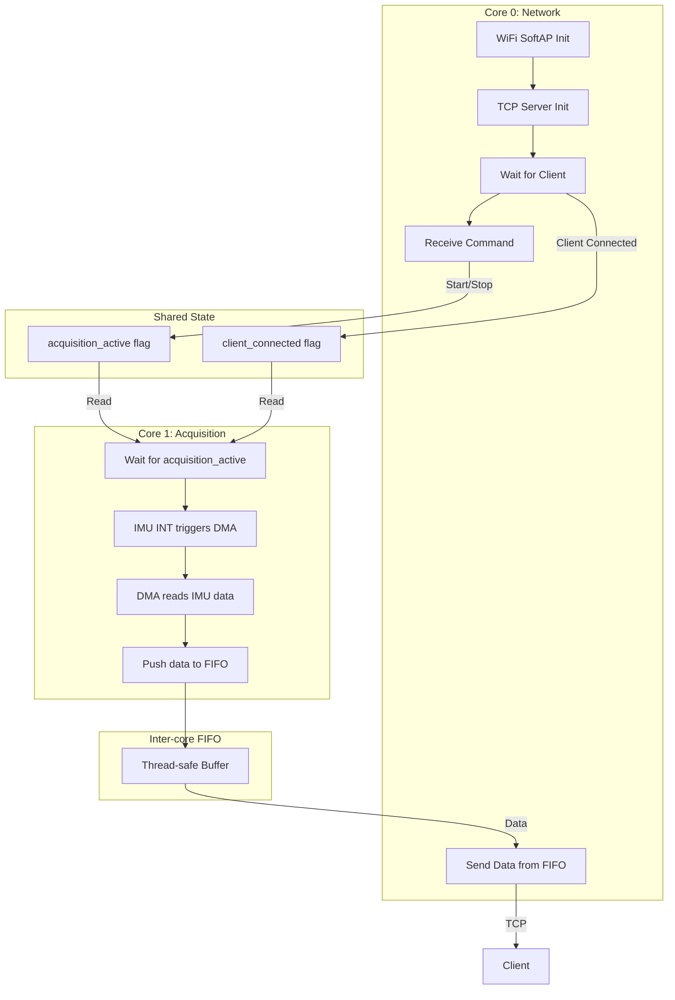
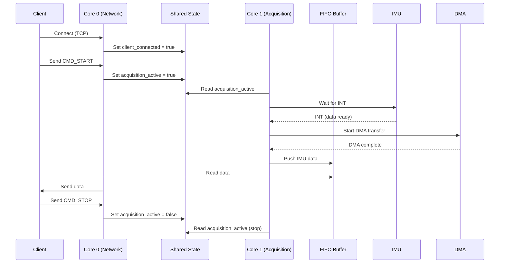

# PicoShakeLog Firmware – Overview

PicoShakeLog is a dual-core firmware for the Raspberry Pi Pico, designed for real-time IMU data acquisition and streaming over WiFi/TCP. The system is modular, with clear separation between acquisition (Core 1) and network communication (Core 0).

## Main Objects & Methods

- **psl_state_handler_t**: Central structure holding all configuration, state, and error flags.
- **Core 0 (Network)**:  
  - `core0_init_wifi_tcp()`: Initializes WiFi SoftAP and TCP server.
  - `core0_main_loop()`: Main loop handling client connections, command parsing, and data streaming.
- **Core 1 (Acquisition)**:  
  - `core1_entry()`: Main acquisition loop, waits for acquisition flag, handles DMA IRQs.
  - `core1_start_dma_transfer()`: Starts DMA transfer on IMU interrupt.
- **FIFO Buffer**:  
  - `psl_fifo_t`: Thread-safe circular buffer for inter-core data exchange.
  - `fifo_init()`, `fifo_free()`: Buffer management.
- **Shared State**:  
  - `psl_shared_state_t`: Synchronizes acquisition and client status between cores.
  - `shared_state_set_acquisition()`, `shared_state_get_acquisition()`: Thread-safe flag access.
- **Hardware Config**:  
  - All SPI, DMA, and WiFi parameters are centralized in `psl_config.h`.

## Principle Diagrams

### System Architecture



### Data Flow



---

This notice gives a concise overview. Doxygen comments in the code provide detailed documentation for each function and structure.

```
doxygen Doxyfile
```
